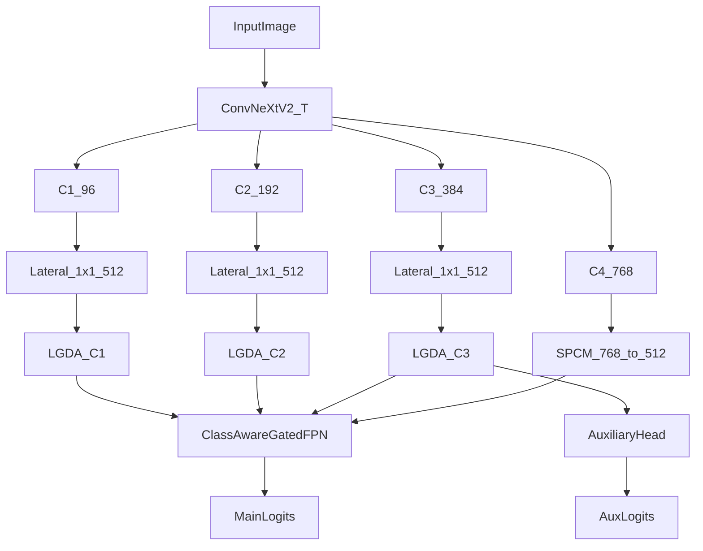

# 增强版 ConvNeXtV2-UPerNet 模型说明

本文档说明当前增强模型的结构、配置入口和训练方式。增强模型不替换原始 `UPerHead` 路径，而是通过独立的 `EnhancedEncoderDecoder` 和 `EnhancedUPerHead` 接入，便于与原始模型做对照实验。

## 入口文件

- 配置文件：`configs/convnextv2_t_enhanced_upernet_oilspill.yaml`
- 训练脚本：`tools/train_enhanced_tmux_2gpu.sh`
- 整网定义：`models/segmentor_enhanced.py`
- 增强解码头：`models/decoder/enhanced_uper_head.py`
- 增强模块：`models/modules/lgda.py`、`models/modules/spcm.py`、`models/modules/class_aware_fpn.py`
- 损失函数：`models/losses.py`

`tools/train.py` 会根据 `decode_head.type` 选择模型：

- `UPerHead` -> `models.segmentor.EncoderDecoder`
- `EnhancedUPerHead` -> `models.segmentor_enhanced.EnhancedEncoderDecoder`

## 当前配置摘要

当前增强配置针对 SAR 溢油分割做了以下设置：

- backbone：`ConvNeXtV2-T`
- decode channels：`512`
- 类别数：`5`
- SPCM 条带核：`strip_kernel_size: 11`
- SPCM local branch：`use_local_branch: false`
- 辅助头输入通道：`512`，接增强后的 C3 lateral
- 损失：`CE + 1.5 * Dice`
- CE 类别权重：`[0.5, 2.0, 1.5, 3.0, 0.5]`
- 训练轮数：`80`

类别权重顺序为：

```text
[sea_surface, oil_spill, look_alike, ship, land]
```

其中 `oil_spill`、`ship` 被加权，以缓解 SAR 溢油数据中的小类和难类问题；`sea_surface`、`land` 被降权，避免大面积背景类主导优化。

## 模型结构

增强模型总体仍是 Encoder-Decoder：



### C1/C2/C3：LGDA 浅层去噪

`EnhancedUPerHead` 先对 C1、C2、C3 做 1x1 lateral convolution，将通道统一到 `512`，再接 `LGDA`。

这样做的原因是 SAR 图像浅层纹理容易受到相干斑噪声干扰。先统一通道再做 LGDA，可以在进入多尺度融合之前对浅层细节进行轻量去噪。

### C4：SPCM 替换 PPM

原始 `UPerHead` 的高层路径是 `PPM + bottleneck`。增强版改为 `SPCM`：

- 保留 pyramid pooling 的多尺度上下文；
- 增加 strip context 分支，适配油膜常见的条带状、细长结构；
- 当前关闭 `local_branch`，减少重叠的 3x3 局部计算；
- 输出通道直接对齐到 `512`，作为最高层 lateral。

### FPN：ClassAwareGatedFPN 替换原始 top-down FPN

`ClassAwareGatedFPN` 接收 `[C1, C2, C3, C4]` 四个已经对齐到 `512` 通道的 lateral。它包含：

- global feature modulation：使用高层全局上下文调制浅层特征；
- gated top-down fusion：用门控控制深层语义向浅层传播的强度；
- learnable scale weights：学习不同尺度的融合权重；
- class prototype enhance：用类别原型为融合特征提供轻量类别先验。

最终输出为 C1 分辨率的融合特征，再经过 `cls_seg` 得到主分割 logits。

## 辅助头设计

原始模型的辅助头直接使用 backbone 的 `features[2]`（C3，384 通道）。当前增强模型改为：

```text
C3 -> 1x1 lateral -> LGDA -> auxiliary head
```

因此 `auxiliary_head.in_channels` 为 `512`。这样主头和辅助头监督的是同一条增强后的中层特征，减少主损失与辅助损失之间的表征不一致。

## 损失函数

增强模型使用 `CEDiceLoss`：

```text
loss = ce_weight * CrossEntropy + dice_weight * Dice
```

当前配置：

```yaml
loss:
  ce_weight: 1.0
  dice_weight: 1.5
  class_weights: [0.5, 2.0, 1.5, 3.0, 0.5]
  ignore_index: 255
```

主头和辅助头均使用同一损失：

```text
total_loss = loss_main + aux_weight * loss_aux
```

当前 `aux_weight` 为 `0.4`。

## 训练与输出目录

默认训练脚本：

```bash
bash tools/train_enhanced_tmux_2gpu.sh
```

默认输出目录：

```text
work_dirs/convnextv2_t_enhanced_upernet_oilspill_scheduled
```

如需避免覆盖已有实验，可通过环境变量指定新的目录：

```bash
WORKDIR=work_dirs/convnextv2_t_enhanced_upernet_oilspill_p0p1_v1 \
TMUX_SESSION=enhanced_oilspill_p0p1_v1 \
bash tools/train_enhanced_tmux_2gpu.sh
```

## 与原始模型的关系

以下文件保持原始路径可用：

- `models/segmentor.py`
- `models/decoder/uper_head.py`
- `configs/convnextv2_t_upernet_oilspill.yaml`

因此原始 ConvNeXtV2-UPerNet 与增强版可以并行训练、评估和对照。
